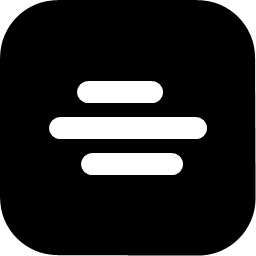

<p align="center">
  
</p>

<h1 align="center">Nimbus</h1>

<p align="center">
  An unofficial Discord client for Windows, written in Rust. No browser inside.
</p>

<p align="center">
  <a href="https://github.com/debugown/Nimbus/releases/latest"></a>
  
  
  
</p>

<p align="center">
  <a href="https://github.com/debugown/Nimbus/releases/latest"><b>Download</b></a>
</p>

> [!WARNING]
> Nimbus is not affiliated with Discord Inc. Third-party clients violate the [Discord Terms of Service](https://discord.com/terms), and your account may be banned. Use it at your own risk.

## Features

**Chat**
- Servers, channels, direct messages, friends, threads and forums.
- Replies, reactions, pinned messages, forwarding and search.
- Mentions show names and role colours. A click on a name opens the profile card.
- Stickers, GIFs, animated emoji, polls and voice messages.
- Paste screenshots and files with Ctrl+V and preview them before sending.
- Open a picture at almost full window size.

**Voice and video**
- Voice channels, DM calls, camera and screen sharing.
- RNNoise noise suppression that runs on your computer.
- Soundboard and a volume setting for each person.

**Bots and servers**
- Slash commands, bot buttons and select menus.
- Server events: the list, "Interested" and creating an event.
- Invites and notification settings for each server and channel.

**Settings**
- Privacy, status, "About me", activity and a profile editor.
- Black, graphite, midnight and light themes.
- Russian and English interface.

Some of the newer features have had little testing on real accounts. If something doesn't work, tell us what you see.

## Install

1. Download `Nimbus-Setup-<version>.exe` from the [releases page](https://github.com/debugown/Nimbus/releases/latest).
2. Run the installer. It doesn't need administrator rights.
3. Sign in with discord.com. The token is saved only on this computer.

## Updates

At start, Nimbus looks for a new version on GitHub and installs it. It checks the ed25519 signature and the SHA-256 hash first, so a swapped file won't run. Without a connection, the current version opens.

## Build

You need Windows and [Rust](https://rustup.rs) with the MSVC toolchain.

```powershell
cd native
cargo build --release
cargo test --release
```

The first full build takes about 15 minutes. You'll find `nimbus-native.exe` in `target\release`.

Demo mode shows a window with made-up data and sends nothing:

```powershell
nimbus-native.exe --demo
```

## License

[GPL-3.0-or-later](https://www.gnu.org/licenses/gpl-3.0.html). The project contains no Discord code, icons or texts. A modified copy of the songbird voice library is in `native/vendor/songbird` under the ISC license.
